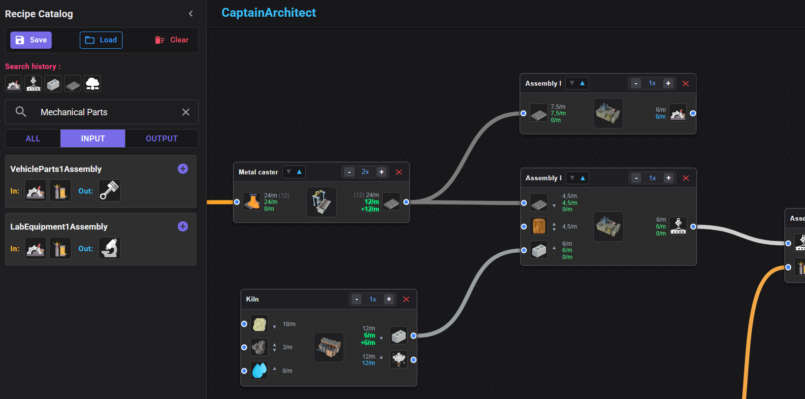
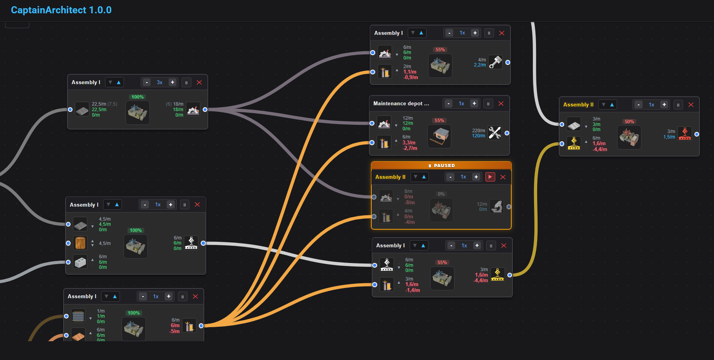
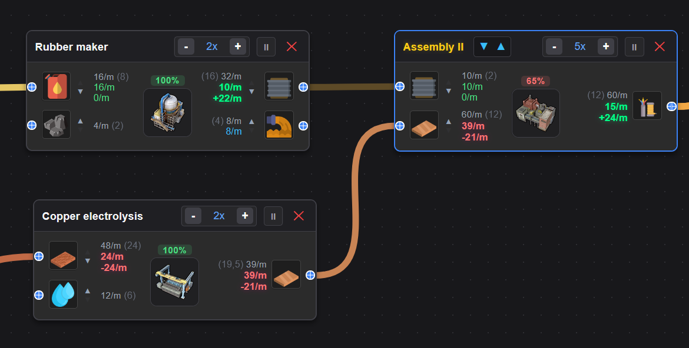

# 🏭 CaptainArchitect

**CaptainArchitect** is an interactive production chain calculator and visual factory layout planner designed for the game **[Captain of Industry](https://www.captain-of-industry.com/)**. Built with **Blazor WebAssembly**, **MudBlazor**, and **Blazor.Diagrams**.

It enables players to visually place machines, connect inputs and outputs using color-coded pipes and conveyors, calculate ratios and production bottlenecks in real time, and export/import factory layouts.

---

## 📸 Preview

---

## ✨ Key Features

* **Interactive Node Canvas**:
  * Smooth pan, zoom, and multi-selection.
  * Newly spawned machines automatically center in the visible viewport.
* **Real-Time Flow Calculation & Balancing (`FlowEngine`)**:
  * Three-tiered rate stack per port: theoretical demand/capacity, actual rate delivered/distributed, and net balance/surplus/deficit per minute.
  * Instant status color coding: green (balanced/surplus), red (deficit/underfed), and blue/gray (unlinked).
* **Machine Tier System & Upgrades**:
  * Upgrade or downgrade machines (Tier 1 to Tier 5) with automatic recalibration of cycle times, throughputs, power, and worker requirements.
  * Color-coded machine titles reflecting the tier level (White, Yellow, Orange, Violet, Electric Cyan).
* **Port Reordering (Inputs & Outputs)**:
  * Move input and output ports up or down (▲ / ▼) on placed machines to prevent tangled connection lines without breaking active links.
* **Recipe Catalog & Smart Filtering**:
  * Collapsible side drawer featuring instant search, filters (All / Inputs / Outputs), and recent search history.
  * Click on any resource badge (on canvas machines or the catalog) to instantly filter recipes that produce or consume it.
* **Save & Load System**:
  * Export and import complete factory layouts as standalone `.json` files (preserves machine tiers, multipliers, coordinates, and custom port configurations).
* **Resource-Themed Pipe & Belt Routing**:
  * Links automatically match the specific resource color (molten iron, crude oil, water, etc.) based on game definitions.

---

## 🛠️ Tech Stack

* **Framework**: [.NET 8 / .NET 9 Blazor WebAssembly](https://dotnet.microsoft.com/apps/aspnet/web-apps/blazor) (Client-Side, 0 backend dependency)
* **UI Components**: [MudBlazor](https://mudblazor.com/)
* **Diagramming Engine**: [Blazor.Diagrams (ZBlazor)](https://github.com/Blazor-Diagrams/Blazor.Diagrams)
* **Game Data**: Extracted from *Captain of Industry* (recipes, machines, products, and icons).
  [CoiDataExtractor](https://github.com/Raph42/CoiDataExtractor)

---

## 🚀 Getting Started

### Prerequisites

* [.NET SDK 8.0 or 9.0+](https://dotnet.microsoft.com/download)
* Any modern web browser with WebAssembly support

### 📦 Deployment (GitHub Pages)

The project is structured to build and publish as a static site via GitHub Actions (.github/workflows/deploy.yml):

* [Live Demo](https://raph42.github.io/CaptainArchitect/)

---

## 📄 License

Distributed under the MIT License. Game assets, data, names, and artwork are property of Mafi Games.